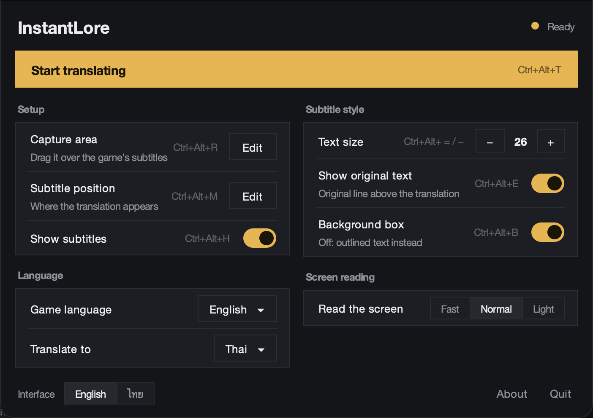

# InstantLore

เวอร์ชัน 1.2 · ผู้พัฒนา: **Mongkol Kijroongviriya**



## ดาวน์โหลด

ดาวน์โหลดได้ที่หน้า [Releases](https://github.com/soulrose/instantlore/releases/latest):
- **Windows:** `InstantLore-x.y.z-windows-x64.exe` ดับเบิลคลิกเปิดได้เลย ไม่ต้องติดตั้ง Python
  ถ้า Windows ขึ้นว่า "Windows protected your PC" ให้กด **More info → Run anyway** (โปรแกรมยังไม่ได้ซื้อใบรับรองนักพัฒนา)
- **Mac (macOS 26 ขึ้นไป):** `InstantLore-x.y.z-mac.dmg` เปิดไฟล์แล้วลาก InstantLore ไปใส่ Applications
  ครั้งแรกให้คลิกขวาที่แอป → **Open** (แอปยังไม่ได้ลงทะเบียนกับ Apple)

ครั้งแรกที่เปิด โปรแกรมจะดาวน์โหลดตัวอ่านตัวหนังสือขนาดเล็ก ต้องต่ออินเทอร์เน็ต

หลักการ: อ่านภาพจอตรง "กล่อง ①" → แปลงภาพเป็นตัวหนังสือ (OCR) → แปล → แสดงใน "กล่อง ②" ลอยทับเกม
วางซับแปลทับซับในเกมได้เลย เพราะโปรแกรมไม่จับภาพหน้าต่างของตัวเอง

## รันจากโค้ดบน Windows

1. ก๊อปโฟลเดอร์ `windows` ไปไว้ในเครื่อง Windows
2. ดับเบิลคลิก `run_windows.bat`
   - ถ้ายังไม่มี Python มันจะติดตั้งให้ แล้วให้ดับเบิลคลิกอีกรอบ
   - ครั้งแรกจะใช้เวลา 1–3 นาทีเพื่อลงโปรแกรมเสริม
3. กด **Edit** ที่ "Capture area" แล้วลากกล่องสีเหลือง ① ไปครอบซับในเกม (ลากมุมขวาล่างเพื่อปรับขนาด)
4. กด **Edit** ที่ "Subtitle position" แล้วลากกล่องสีเขียว ② ไปไว้ตรงที่อยากให้ซับแปลขึ้น
5. กด **Start translating** หรือ **Ctrl+Alt+T**

ถ้าอยากได้ไฟล์ `.exe` ไว้แชร์ให้คนอื่น: รัน `run_windows.bat` หนึ่งครั้งก่อน แล้วรัน `build_exe.bat` จะได้ไฟล์ `dist\InstantLore.exe`

**ข้อสำคัญบน Windows**
- ตั้งเกมเป็น **Borderless / Windowed Fullscreen** เพราะโหมด Exclusive Fullscreen จะบังซับแปล
- ถ้าปุ่มลัดใช้ไม่ได้ตอนอยู่ในเกม ให้คลิกขวา `run_windows.bat` → **Run as administrator** (บางเกมรันแบบ admin)
- ใช้ได้กับ Windows 10 (เวอร์ชัน 2004 ขึ้นไป) และ Windows 11

**กดปุ่ม X:** ครั้งแรกจะถามว่าจะ **ย่อ** (โปรแกรมยังแปลต่อเบื้องหลัง) หรือ **ปิดโปรแกรม** ถ้าติ๊ก "จำการเลือกนี้" ครั้งต่อไปจะไม่ถามอีก ปุ่ม **Quit** มุมขวาล่างใช้ปิดโปรแกรมได้เสมอ
ถ้าอยากให้กลับมาถามอีก ให้เปิดไฟล์ `.instantlore.json` ในโฟลเดอร์ผู้ใช้ แล้วแก้ `"close_action"` เป็น `"ask"`

## สร้างแอปบน Mac จากโค้ด

```bash
cd mac && ./build.sh && open InstantLore.app
```

ครั้งแรกเครื่องจะขอสิทธิ์ **Screen Recording** ให้อนุญาตแล้วเปิดโปรแกรมใหม่ เมนูอยู่ที่ไอคอน 💬 บนแถบด้านบน
ถ้าเลือกระบบแปล Apple จะแปลแบบออฟไลน์ได้ แต่ต้องโหลดภาษาก่อนใน System Settings → General → Language & Region → Translation Languages

## ภาษาของโปรแกรม
ค่าเริ่มต้นเป็นภาษาอังกฤษ เปลี่ยนเป็นไทยได้ที่ **Interface** มุมซ้ายล่าง (Windows) หรือเมนู 💬 → **Interface language** (Mac)

## เลือกภาษาที่จะแปล
- **ภาษาของเกม:** ตรวจอัตโนมัติ, อังกฤษ, ญี่ปุ่น, จีน (ตัวย่อ/ตัวเต็ม), เกาหลี, ฝรั่งเศส, เยอรมัน, สเปน, อิตาลี, โปรตุเกส, รัสเซีย, ไทย
- **แปลเป็น:** ไทย, อังกฤษ, ญี่ปุ่น, จีน, เกาหลี, เวียดนาม, อินโดนีเซีย, มลายู, ลาว, พม่า, เขมร, ฝรั่งเศส, สเปน
- ถ้าเลือกภาษาเกมเป็นเกาหลี รัสเซีย หรือไทย ครั้งแรกโปรแกรมจะดาวน์โหลดตัวอ่านภาษานั้นก่อน (ต้องต่อเน็ต ใช้เวลาไม่กี่วินาที)

## ปุ่มลัด (ทั้งสองระบบ)

| ปุ่ม | ทำอะไร |
|---|---|
| Ctrl+Alt+T | เริ่ม / หยุดแปล |
| Ctrl+Alt+R | แก้ไขกล่อง ① (อ่านซับในเกม) กดอีกครั้งเมื่อเสร็จ |
| Ctrl+Alt+M | ย้าย / ปรับขนาดกล่อง ② (ซับแปล) กดอีกครั้งเมื่อเสร็จ |
| Ctrl+Alt+H | ซ่อน / แสดงซับแปล |
| Ctrl+Alt+E | แสดงข้อความต้นฉบับคู่กับคำแปล (เอาไว้ฝึกภาษา) |
| Ctrl+Alt+B | เปิด/ปิดกล่องพื้นหลัง (ปิดแล้วตัวหนังสือจะมีขอบดำแทน) |
| Ctrl+Alt+= / Ctrl+Alt+- | ตัวอักษรใหญ่ขึ้น / เล็กลง |

## กินเครื่องแค่ไหน (Windows)
วัดบนแถบซับขนาด 2400×300 พิกเซล:

| | ก่อนปรับ | หลังปรับ |
|---|---|---|
| CPU ต่อการอ่าน 1 ครั้ง | 3.3 วินาที | 0.05–0.11 วินาที |
| RAM | 1,800 MB | ~240 MB |
| ตอนซับยังไม่เปลี่ยน | อ่านซ้ำทุกครั้ง | ข้ามไป (< 1 มิลลิวินาที) |

- ใช้ CPU สูงสุด 2 คอร์ และตั้งความสำคัญของโปรแกรมให้ต่ำกว่าเกม เกมจึงได้ CPU ก่อนเสมอ
- ไม่ใช้การ์ดจอเลย

## เคล็ดลับให้แปลแม่นขึ้น
- ทำกล่อง ① ให้ครอบแค่ซับ อย่าให้กินพื้นที่ HUD หรือแผนที่มากเกินไป
- เปิด "พื้นหลังซับ" (subtitle background) ในตั้งค่าของเกม OCR จะอ่านได้แม่นขึ้นมาก
- ระบบจะแปลเฉพาะตอนที่ซับเปลี่ยน และจะซ่อนซับแปลเองเมื่อซับในเกมหายไป
- การแปลใช้ Google ซึ่งต้องต่อเน็ต ส่วน OCR ทำงานในเครื่อง

## สร้างเวอร์ชันใหม่ (สำหรับผู้พัฒนา)
1. แก้เลขเวอร์ชันใน `windows/instantlore.py` (`APP_VERSION`), `mac/main.swift` (`appVersion`) และ `mac/build.sh`
2. ติด tag แล้ว push เช่น `git tag v1.3.0 && git push origin v1.3.0`
   GitHub Actions จะสร้าง exe ของ Windows แล้วแนบไว้ในหน้า Release ให้เอง
3. สร้างไฟล์ Mac ด้วย `cd mac && ./build.sh dmg` แล้วแนบด้วย `gh release upload v1.3.0 mac/InstantLore-1.3.0-mac.dmg`
