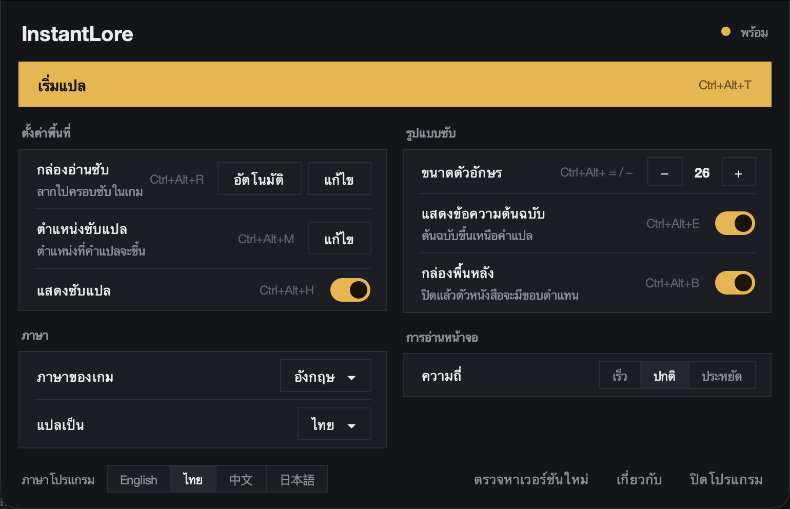
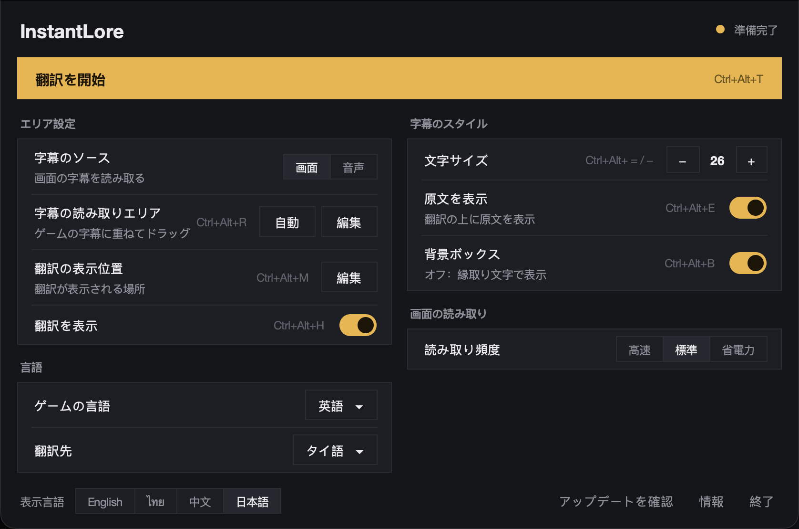
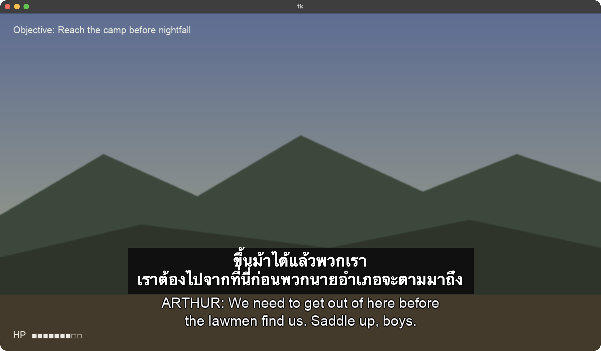
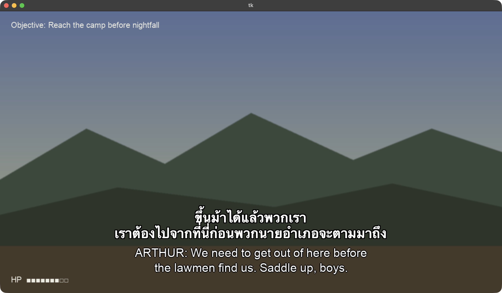
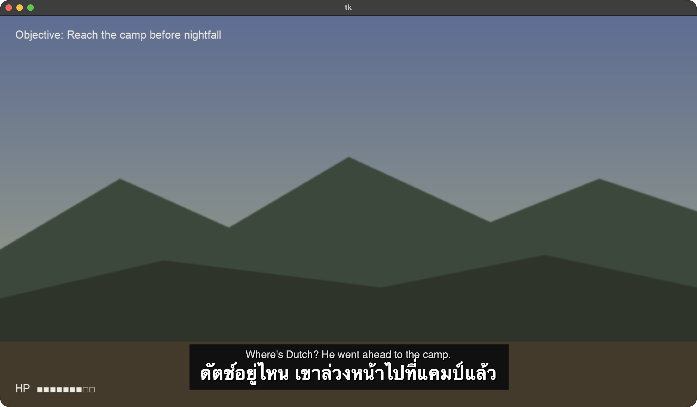
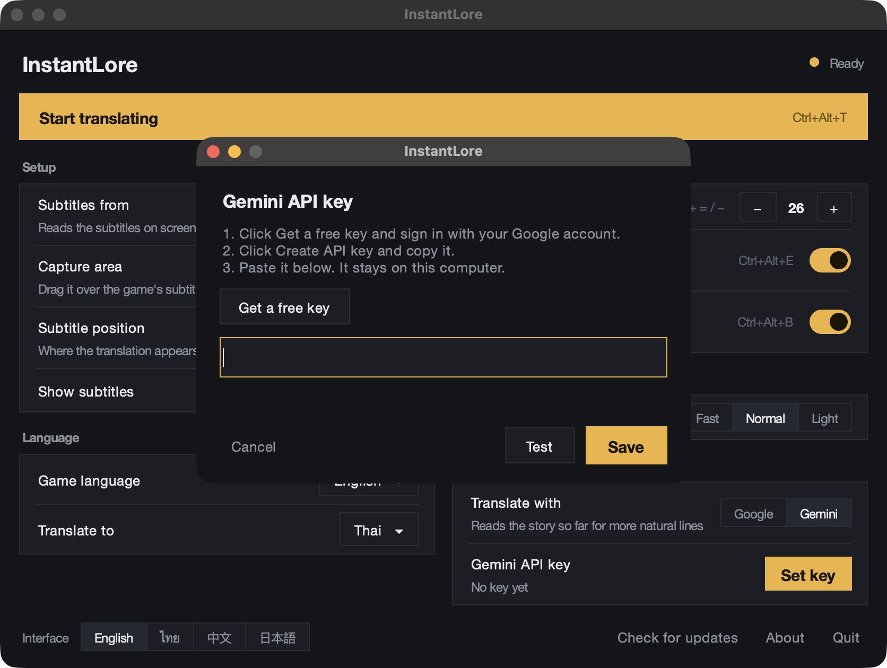

# InstantLore

Live translated subtitles for games. Version 1.5.1 · Developed by **Soulrose**


<details><summary>Thai, Chinese and Japanese interface</summary>





</details>

InstantLore reads a game's subtitles from your screen, translates them, and shows the translation in a floating box over the game. For games without subtitles, it can listen to the speech instead (Windows 11).

## What it looks like

| Screen mode, background box | Screen mode, outlined text | Listen mode (game without subtitles) |
|---|---|---|
|  |  |  |

You choose where the translation sits, for example just above the game's own subtitles. In Listen mode the original line heard by Live Captions appears above the translation (turn it off with **Show original text**).

## Features

- **Reads subtitles from the screen** and translates them as they change. It hides the translation when the subtitle disappears.
- **Finds the subtitles for you:** one click, and the capture box lands on the game's subtitles.
- **Listen mode** for games without subtitles, using Windows 11 Live Captions.
- **Overlay on top of the game:** you can place the translation right over the original subtitles, because InstantLore leaves its own windows out of the screen capture.
- **Better translations with Gemini (optional):** sign in to Google AI Studio for a free key, and Gemini translates with the story so far in mind. Without a key, Google Translate works with no setup.
- **13 game languages, 13 target languages,** and an interface in English, Thai, Chinese or Japanese.
- **Light on your PC:** about 0.1 s of CPU per read, about 240 MB of memory, no GPU use. See [Performance](#performance).

## Download

Get the latest build from [Releases](https://github.com/soulrose/instantlore/releases/latest).

| System | File | First launch |
|---|---|---|
| Windows 10 (2004 or later) / 11 | `InstantLore-x.y.z-windows-x64.exe` | Double-click to run, no install needed. If Windows shows "Windows protected your PC", click **More info → Run anyway** (the app isn't signed with a paid certificate yet). |
| macOS 26 or later | `InstantLore-x.y.z-mac.dmg` | Drag InstantLore into Applications. Right-click it and choose **Open** the first time (it isn't notarized by Apple yet), then allow **Screen Recording** and reopen the app. |

The first launch needs an internet connection to download a small text-recognition model.

To update, click **Check for updates** at the bottom of the window (Mac: **Check for Updates…** in the menu). If a newer version is out, InstantLore opens its download page.

## Quick start

1. Start the game and wait for a subtitle to appear.
2. Click **Auto** next to **Capture area** (or press **Ctrl+Alt+A**). InstantLore watches the screen for about 5 seconds and places the yellow box ① over the subtitles. Adjust it if needed and click **Done**.
   To place it by hand, click **Edit** instead and drag the box over the subtitles; drag the bottom-right corner to resize it.
3. Click **Edit** next to **Subtitle position** and drag the green box ② to where you want the translation, then click **Done**.
4. Click **Start translating** (**Ctrl+Alt+T**).

InstantLore remembers both boxes, so next time you only need step 4.

## Listen mode (Windows 11)

For games without subtitles, set **Subtitles from** to **Listen**. InstantLore uses Windows 11's built-in **Live Captions** to turn the game's speech into text, and translates each sentence as soon as it's spoken. Windows does the speech recognition, so InstantLore adds almost no load.

- Needs Windows 11 22H2 or later. InstantLore opens Live Captions for you and minimizes its window while listening.
- The first time, Windows may ask you to download the Live Captions language. Choose the spoken language in Live Captions' own settings; English works best.
- For better recognition, lower the game's music and effects volume or raise the dialogue volume. Battle noise causes mistakes.

## Fullscreen games

| Game display mode | Translation overlay | Auto / screen reading |
|---|---|---|
| Borderless or Windowed fullscreen | Works | Works |
| Exclusive fullscreen | Hidden by the game | Sees a black screen |

Set the game to **Borderless** or **Windowed fullscreen**; it looks the same as fullscreen. If InstantLore can only see a black screen, the status line tells you.

You can set everything up without leaving the game:
- **Auto:** with a subtitle on screen, press **Ctrl+Alt+A**, then **Ctrl+Alt+R** once the box looks right.
- **By hand:** press **Ctrl+Alt+R** (capture area) or **Ctrl+Alt+M** (subtitle position). If the game holds the mouse, pause the game to get the cursor back, or move the box with **Ctrl+Alt+arrow keys** and resize it with **Ctrl+Alt+Shift+arrow keys**. Press the same hotkey again when done.

## Hotkeys

On the Mac, Ctrl+Alt is **⌃⌥** (Control+Option).

| Keys | Action | Mac |
|---|---|---|
| Ctrl+Alt+T | Start / stop translating | ✓ |
| Ctrl+Alt+A | Find the subtitles automatically | |
| Ctrl+Alt+R | Edit the capture area (press again when done) | ✓ |
| Ctrl+Alt+M | Edit the subtitle position (press again when done) | ✓ |
| Ctrl+Alt+arrows | Move the box you're editing | |
| Ctrl+Alt+Shift+arrows | Resize the box you're editing | |
| Ctrl+Alt+H | Show / hide the translation | ✓ |
| Ctrl+Alt+E | Show the original line above the translation | ✓ |
| Ctrl+Alt+B | Background box on / off (off: outlined text) | ✓ |
| Ctrl+Alt+= / Ctrl+Alt+- | Larger / smaller text | ✓ |

## Languages

- **Game language:** Auto detect, English, Japanese, Chinese (Simplified / Traditional), Korean, French, German, Spanish, Italian, Portuguese, Russian, Thai. Korean, Russian and Thai download their own text-recognition model the first time you pick them.
- **Translate to:** Thai, English, Japanese, Chinese, Korean, Vietnamese, Indonesian, Malay, Lao, Burmese, Khmer, French, Spanish
- **Interface:** English, Thai, Chinese or Japanese. It follows your system language on first launch (English if your system uses another language). Change it under **Interface** at the bottom of the window (Mac: **Interface language** in the menu).

## Translation: Google or Gemini (Windows)

Under **Translation → Translate with**:

| | Google (default) | Gemini |
|---|---|---|
| Setup | None | A free API key, once |
| Quality | Word-for-word, can sound stiff | Natural, keeps the tone and names, reads the previous lines for context |
| Limits | None in practice | Free quota per minute; when it runs out, InstantLore switches to Google for a minute |

To use Gemini:
1. Choose **Gemini**. The key window opens.
2. Click **Get a free key**, sign in with your Google account on Google AI Studio, click **Create API key** and copy it. No credit card needed.
3. Paste the key, click **Test** to check it, then **Save**.

If Gemini can't answer (wrong key, quota used up, no internet, slow reply), InstantLore translates that line with Google instead and says why in the status line. Your key is stored only in `.instantlore.json` on your computer.



## Windows and Mac

| | Windows | Mac |
|---|---|---|
| Read subtitles from the screen | ✓ | ✓ |
| Find subtitles automatically | ✓ | |
| Listen mode | ✓ (Windows 11) | |
| Move boxes with arrow keys | ✓ | |
| Translation | Google Translate, or Gemini with a free key | Google Translate, or Apple Translation offline |
| Where it lives | Its own window | Menu bar (💬 icon) |

For offline translation on the Mac, choose **Translator → Apple** in the menu and download the languages in System Settings → General → Language & Region → Translation Languages.

## Closing the window (Windows)

The first time you press X, InstantLore asks whether to **Minimize** (keeps translating in the background) or **Quit**. Tick **Remember my choice** to skip the question next time. The **Quit** button at the bottom right always closes the app.

To be asked again, open `.instantlore.json` in your user folder and set `"close_action"` to `"ask"`.

## Troubleshooting

| Problem | Fix |
|---|---|
| The translation doesn't appear over the game | Set the game to Borderless or Windowed fullscreen. |
| Status says it can't see the game | Same as above: exclusive fullscreen blocks screen capture. |
| Hotkeys don't work while the game is focused | Some games run as administrator; run InstantLore as administrator too. |
| Wrong or missing words | Keep the capture area tight around the subtitles, and turn on the game's subtitle background if it has one. |
| Auto doesn't find the subtitles | Make sure a subtitle is on screen while it looks, or place the box by hand with **Edit**. |
| Listen mode says it needs Windows 11 | Live Captions only exists on Windows 11 22H2 or later. Use screen reading instead. |
| Windows blocks the exe | Click **More info → Run anyway**. |

## Privacy

Text recognition runs on your computer. The recognized subtitle text is sent to Google Translate, or to Gemini if you chose it, to be translated (Apple Translation on the Mac works offline). With Gemini, the last few lines are sent along as context. No screenshots or audio leave your computer; in Listen mode, Windows Live Captions processes the audio on your PC.

## How fast

The translation appears about **1–2 seconds** after the game's subtitle (Screen reading: Normal, Google Translate). Lines InstantLore has already translated appear immediately.

To make it quicker (Windows):
- **Screen reading → Fast** reads the screen every 0.3 s instead of 0.5 s.
- **Instant subtitles** translates a line as soon as it appears instead of waiting for it to settle, about 0.5 s sooner. In games where subtitles type out letter by letter, the translation updates as the line grows. In Listen mode it treats a 1-second pause as the end of a sentence instead of 2 seconds.

Gemini usually takes a little longer to reply than Google Translate.

## Performance

Measured on a 2400×300 px subtitle strip (Windows build):

| | Default OCR settings | InstantLore |
|---|---|---|
| CPU per read | 3.3 s | 0.05–0.11 s |
| Memory | 1,800 MB | ~240 MB |
| Unchanged subtitle | Read again | Skipped (< 1 ms) |

OCR uses at most 2 CPU threads, the process runs at below-normal priority so the game always comes first, and nothing runs on the GPU.

## Build from source

**Windows:** copy the `windows` folder to the PC and double-click `run_windows.bat`. It installs Python if needed (run it again afterwards) and sets everything up on the first run, which takes 1–3 minutes. `build_exe.bat` builds `dist\InstantLore.exe`.

**Mac:**

```bash
cd mac && ./build.sh && open InstantLore.app
```

`./build.sh dmg` also packages `InstantLore-x.y.z-mac.dmg`.

## Releasing a new version

1. Set the same version in `windows/instantlore.py` (`APP_VERSION`), `mac/main.swift` (`appVersion`) and `mac/build.sh` (`CFBundleShortVersionString`).
2. Commit, push, then tag: `git tag -a vX.Y.Z -m "InstantLore X.Y.Z" && git push origin vX.Y.Z`.
   GitHub Actions builds the Windows exe, runs a self-test on it, and attaches it to the release.
3. Build the Mac package with `cd mac && ./build.sh dmg` and attach it: `gh release upload vX.Y.Z mac/InstantLore-X.Y.Z-mac.dmg`.

## License

InstantLore is released under the [MIT License](LICENSE). © 2026 Soulrose

The Windows build bundles third-party libraries under their own licenses: RapidOCR and its PP-OCR models (Apache-2.0), ONNX Runtime (MIT), uiautomation (Apache-2.0), mss (MIT), keyboard (MIT) and NumPy (BSD-3-Clause).

## Credits

- Text recognition: [RapidOCR](https://github.com/RapidAI/RapidOCR) (PP-OCR models)
- Reading Windows Live Captions follows the approach of [LiveCaptions-Translator](https://github.com/SakiRinn/LiveCaptions-Translator)
