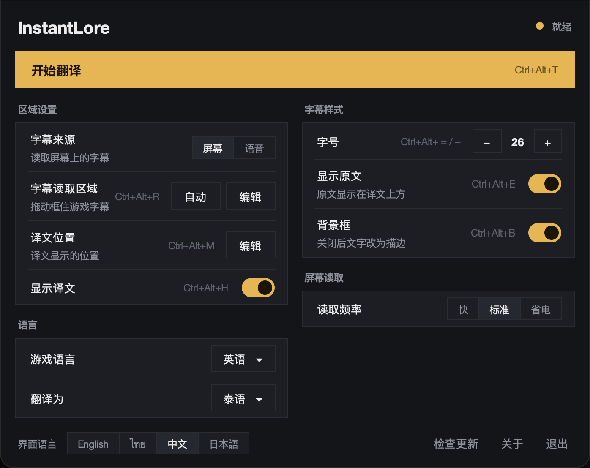

# InstantLore

Version 1.4.0 · Developed by **Soulrose**


<details><summary>Thai, Chinese and Japanese interface</summary>





</details>

InstantLore reads the subtitles from an area of your screen, translates them, and shows the translation in a floating box over the game. You can place the translation right on top of the game's own subtitles: InstantLore leaves its own windows out of the screen capture, so it still reads the original text underneath.

## Download

Get the latest build from [Releases](https://github.com/soulrose/instantlore/releases/latest):

- **Windows 10 (2004 or later) / 11:** `InstantLore-x.y.z-windows-x64.exe`. Double-click to run; no install or Python needed.
  If Windows shows "Windows protected your PC", click **More info → Run anyway**. The app isn't signed with a paid certificate yet.
- **macOS 26 or later:** `InstantLore-x.y.z-mac.dmg`. Open it and drag InstantLore into Applications.
  The first time, right-click the app and choose **Open**, because it isn't notarized by Apple yet.

On first launch InstantLore downloads a small text-recognition model, so it needs an internet connection.

**Updating:** click **Check for updates** at the bottom of the window (Mac: **Check for Updates…** in the menu). If a newer version is out, InstantLore offers to open its download page.

## How to use

1. With a subtitle showing in the game, click **Auto** next to **Capture area** (or press **Ctrl+Alt+A**). InstantLore watches the screen for about 5 seconds, finds the subtitles and places the yellow box ① over them. Adjust it if needed, then click **Done**.
   To place it by hand instead, click **Edit** and drag the box over the subtitles; drag the bottom-right corner to resize it.
2. Click **Edit** next to **Subtitle position** and drag the green box ② to where you want the translation to appear.
3. Click **Start translating**, or press **Ctrl+Alt+T**.

### Games without subtitles: Listen mode (Windows 11)

Set **Subtitles from** to **Listen**. InstantLore then uses Windows 11's built-in **Live Captions** to turn the game's speech into text, and translates each sentence as soon as it's spoken. It adds almost no load, because Windows does the speech recognition.

- Needs Windows 11 22H2 or later. InstantLore opens Live Captions for you and minimizes its window while listening.
- The first time, Windows may ask you to download the Live Captions language. Choose the spoken language in Live Captions' own settings (English works best).
- Lower the game's music and effects volume, or raise the dialogue volume, for better recognition. Battle noise causes mistakes.
- Listen mode is Windows only; the Mac version reads the screen.

### Fullscreen games

| Game display mode | Translation overlay | Auto detect |
|---|---|---|
| Borderless / Windowed fullscreen | Works | Works |
| Exclusive fullscreen | Hidden by the game | Sees a black screen |

Set the game to **Borderless** or **Windowed fullscreen**; it looks the same as fullscreen. If InstantLore can only see a black screen, it tells you so in the status line.

You don't need to leave the game to set things up:
- **Auto:** with a subtitle on screen, press **Ctrl+Alt+A**, then **Ctrl+Alt+R** when the box looks right.
- **By hand:** press **Ctrl+Alt+R** (capture area) or **Ctrl+Alt+M** (subtitle position). If the game holds the mouse, pause the game to get the cursor back, or move the box with **Ctrl+Alt+arrow keys** and resize it with **Ctrl+Alt+Shift+arrow keys**. Press the same hotkey again when done.

Tips for Windows:
- If the hotkeys don't work while the game is focused, run InstantLore as administrator (some games run elevated).

**Closing the window:** the first time you press X, InstantLore asks whether to **Minimize** (keeps translating in the background) or **Quit**. Tick **Remember my choice** to skip the question next time. The **Quit** button in the bottom-right corner always closes the app.
To be asked again, open `.instantlore.json` in your user folder and set `"close_action"` to `"ask"`.

On the Mac, InstantLore lives in the menu bar (💬 icon) and asks for **Screen Recording** permission the first time; allow it and reopen the app. You can switch to Apple Translation for offline translation after downloading the languages in System Settings → General → Language & Region → Translation Languages.

## Languages

- **Interface:** English, Thai, Chinese or Japanese. It follows your system language on first launch (English if your system uses another language), and you can switch it any time under **Interface** in the bottom-left corner (Windows) or **Interface language** in the menu (Mac).
- **Game language:** Auto detect, English, Japanese, Chinese (Simplified / Traditional), Korean, French, German, Spanish, Italian, Portuguese, Russian, Thai
- **Translate to:** Thai, English, Japanese, Chinese, Korean, Vietnamese, Indonesian, Malay, Lao, Burmese, Khmer, French, Spanish

Korean, Russian and Thai use their own text-recognition model, downloaded the first time you pick them.

## Hotkeys

| Keys | Action |
|---|---|
| Ctrl+Alt+T | Start / stop translating |
| Ctrl+Alt+A | Find the subtitles automatically (Windows) |
| Ctrl+Alt+R | Edit the capture area (press again when done) |
| Ctrl+Alt+M | Move / resize the subtitle box (press again when done) |
| Ctrl+Alt+arrows | Move the box you're editing |
| Ctrl+Alt+Shift+arrows | Resize the box you're editing |
| Ctrl+Alt+H | Show / hide the translated subtitles |
| Ctrl+Alt+E | Show the original line above the translation |
| Ctrl+Alt+B | Background box on / off (off: outlined text) |
| Ctrl+Alt+= / Ctrl+Alt+- | Larger / smaller text |

## Performance (Windows)

Measured on a 2400×300 px subtitle strip:

| | Default OCR settings | InstantLore |
|---|---|---|
| CPU per read | 3.3 s | 0.05–0.11 s |
| Memory | 1,800 MB | ~240 MB |
| Unchanged subtitle | Read again | Skipped (< 1 ms) |

OCR uses at most 2 CPU threads, the process runs at below-normal priority so the game always comes first, and nothing runs on the GPU.

## Tips for better results

- Keep the capture area tight around the subtitles; leave the HUD and minimap out.
- Turn on the game's own subtitle background if it has one. OCR reads it much more reliably.
- InstantLore only translates when the subtitle changes, and hides the translation when the subtitle disappears.
- Translation uses Google Translate (online). Text recognition runs on your computer.

## Run from source

**Windows:** copy the `windows` folder to the PC and double-click `run_windows.bat`. It installs Python if needed (run it again afterwards) and sets everything up on the first run, which takes 1–3 minutes. `build_exe.bat` builds `dist\InstantLore.exe`.

**Mac:**

```bash
cd mac && ./build.sh && open InstantLore.app
```

`./build.sh dmg` also packages `InstantLore-x.y.z-mac.dmg`.

## Releasing a new version

1. Update the version in `windows/instantlore.py` (`APP_VERSION`), `mac/main.swift` (`appVersion`) and `mac/build.sh`.
2. Tag and push, for example `git tag -a v1.3.0 -m "InstantLore 1.3.0" && git push origin v1.3.0`.
   GitHub Actions builds the Windows exe, runs a self-test on it, and attaches it to the release.
3. Build the Mac package with `cd mac && ./build.sh dmg` and attach it with `gh release upload v1.3.0 mac/InstantLore-1.3.0-mac.dmg`.
