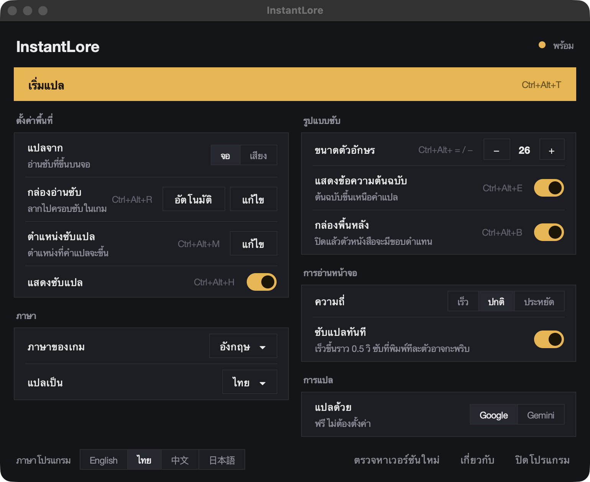
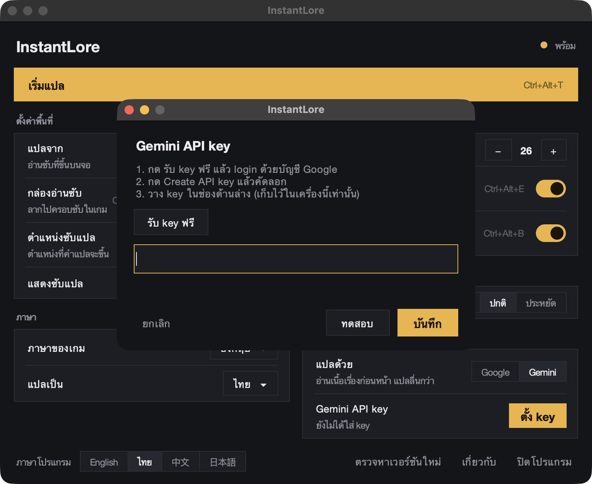

# เล่นเกม PS5 พร้อมซับไทยด้วย InstantLore

คู่มือนี้ทำให้เล่นเกม PS5 บนทีวีได้ตามปกติ แต่มี**ซับไทยขึ้นทับเกมเอง** ไม่ต้องถือมือถือถ่ายแล้วถามทีละประโยค

```
PS5 ──(เน็ตบ้าน)──> คอม/โน้ตบุ๊ก ──(สาย HDMI)──> ทีวี
                     Remote Play + InstantLore
                          ↑
                     จอย PS5 (สาย USB)
```

หลักการ: PS5 ส่งภาพเกมมาที่คอมผ่านแอป **PS Remote Play** แล้ว **InstantLore** อ่านซับจากภาพนั้นแปลเป็นไทย จากนั้นคอมส่งภาพทั้งหมด (เกม + ซับไทย) ขึ้นทีวี

---

## ต้องมีอะไรบ้าง

- **คอมหรือโน้ตบุ๊ก Windows 10/11** (ถ้ามีแต่ Mac ก็ใช้ได้ แต่บางฟีเจอร์ เช่น Gemini มีเฉพาะ Windows)
- **สาย HDMI** ต่อคอมเข้าทีวี (ถ้าเล่นบนจอคอมเลยก็ไม่ต้องใช้)
- **สาย USB-C** ต่อจอย PS5 เข้าคอม
- **เน็ตบ้าน** ถ้าเป็นไปได้ให้ต่อ**สาย LAN** ทั้ง PS5 และคอม จะลื่นกว่า WiFi มาก
- **บัญชี PSN** ที่ใช้บน PS5 อยู่แล้ว
- **บัญชี Google** สำหรับขอ key ฟรีของ Gemini (ทำให้แปลดีกว่า Google Translate)

---

## ตอนที่ 1: ตั้งค่า PS5 (ทำครั้งเดียว)

1. ที่ PS5 ไปที่ **Settings → System → Remote Play** แล้วเปิด **Enable Remote Play**
2. ไปที่ **Settings → System → Power Saving → Features Available in Rest Mode**
   แล้วเปิด **Stay Connected to the Internet** และ **Enable Turning On PS5 from Network**
   (เพื่อให้คอมเปิด PS5 จากโหมดพักได้เอง)

## ตอนที่ 2: ลง PS Remote Play บนคอม (ทำครั้งเดียว)

1. ค้นหา **"PS Remote Play"** ในเว็บ playstation.com แล้วดาวน์โหลดตัวสำหรับ Windows
2. ติดตั้งแล้ว login ด้วยบัญชี PSN เดียวกับ PS5
3. เสียบจอย PS5 เข้าคอมด้วยสาย USB
4. กดเชื่อมต่อ PS5 รอสักครู่ ภาพเกมจะขึ้นบนคอม
5. กดขยายหน้าต่าง Remote Play ให้**เต็มจอ**

## ตอนที่ 3: ลง InstantLore (ทำครั้งเดียว)

1. ดาวน์โหลด `InstantLore-x.y.z-windows-x64.exe` จาก [หน้า Releases](https://github.com/soulrose/instantlore/releases/latest)
2. ดับเบิลคลิกเปิด ถ้า Windows ขึ้นว่า "Windows protected your PC" ให้กด **More info → Run anyway**
3. ถ้าโปรแกรมเป็นภาษาอังกฤษ กดเปลี่ยนเป็น **ไทย** ได้ที่มุมซ้ายล่าง (ภาษาโปรแกรม)
4. ครั้งแรกโปรแกรมจะดาวน์โหลดตัวอ่านตัวหนังสือขนาดเล็ก ต้องต่อเน็ตไว้



## ตอนที่ 4: ใช้ Gemini ให้แปลดีขึ้น (ทำครั้งเดียว แนะนำมาก)

1. ที่หัวข้อ **การแปล → แปลด้วย** กด **Gemini** หน้าต่างใส่ key จะขึ้นมาเอง
2. กด **รับ key ฟรี** เว็บ Google AI Studio จะเปิดขึ้นมา ให้ login ด้วยบัญชี Google
3. กด **Create API key** แล้วกดคัดลอก key (ไม่ต้องผูกบัตร)
4. กลับมาที่ InstantLore วาง key ในช่อง กด **ทดสอบ** ถ้าขึ้นว่า "ใช้ได้" ก็กด **บันทึก**



> ถ้า Gemini ใช้ไม่ได้ชั่วคราว (เช่น โควตาฟรีหมด) โปรแกรมจะใช้ Google Translate แทนเองอัตโนมัติ ไม่ค้าง

## ตอนที่ 5: ตั้งตำแหน่งซับ (ทำครั้งเดียวต่อเกม)

1. เปิดเกมใน Remote Play แล้วเล่นไปจนมี**ซับขึ้น**บนจอ
2. กด **Ctrl+Alt+A** (หรือปุ่ม **อัตโนมัติ** ในโปรแกรม) โปรแกรมจะดูจอประมาณ 5 วินาที แล้ววางกล่องสีเหลืองครอบซับให้เอง
3. ถ้ากล่องอยู่ถูกที่แล้ว กด **Ctrl+Alt+R** เพื่อจบ
4. ถ้าอยากย้ายตำแหน่งซับไทย กด **Ctrl+Alt+M** แล้วลากกล่องสีเขียวไปตรงที่ชอบ จากนั้นกด **Ctrl+Alt+M** อีกครั้ง

> ถ้าเมาส์ถูกเกมจับไว้ ใช้ **Ctrl+Alt+ลูกศร** เลื่อนกล่องแทนได้ และ **Ctrl+Alt+Shift+ลูกศร** ปรับขนาด

## ตอนที่ 6: เล่นเกม

กด **Ctrl+Alt+T** (หรือปุ่ม **เริ่มแปล**) แล้วเล่นได้เลย ซับไทยจะขึ้นทุกครั้งที่ซับในเกมเปลี่ยน และหายไปเองเมื่อซับในเกมหายไป

**ครั้งต่อไป** ทำแค่: เปิด Remote Play → เปิด InstantLore → กด Ctrl+Alt+T

---

## ตั้งค่าเพิ่มที่ช่วยได้

| อยากได้ | ทำแบบนี้ |
|---|---|
| ซับไทยขึ้นเร็วขึ้น | เปิด **ซับแปลทันที** และตั้ง **ความถี่ → เร็ว** |
| ตัวหนังสือใหญ่/เล็กลง | **Ctrl+Alt+=** / **Ctrl+Alt+-** |
| ไม่อยากเห็นภาษาอังกฤษด้านบน | ปิด **แสดงข้อความต้นฉบับ** (Ctrl+Alt+E) |
| ไม่อยากให้มีกล่องดำ | ปิด **กล่องพื้นหลัง** (Ctrl+Alt+B) ตัวหนังสือจะมีขอบดำแทน |
| เกมที่**ไม่มีซับ** | ตั้ง **แปลจาก → เสียง** (ต้องเป็น Windows 11) โปรแกรมจะฟังเสียงพูดแล้วแปล |
| อ่านซับในเกมได้แม่นขึ้น | เปิด**พื้นหลังซับ** (Subtitle background) ในตั้งค่าของเกม |

## เจอปัญหา

| ปัญหา | ทางแก้ |
|---|---|
| ภาพ Remote Play กระตุก | ต่อสาย LAN ทั้ง PS5 และคอม หรือลดความละเอียดในตั้งค่าของ Remote Play |
| ซับไทยไม่ขึ้นเลย | ดูข้อความที่มุมขวาบนของ InstantLore ว่าบอกอะไร และอย่าย่อหน้าต่าง Remote Play |
| กด Ctrl+Alt+A แล้วไม่เจอซับ | ต้องมีซับขึ้นอยู่บนจอตอนกด หรือกด **แก้ไข** แล้วลากกล่องเอง |
| ปุ่มลัดกดไม่ติดตอนอยู่ในเกม | คลิกขวาที่ InstantLore แล้วเลือก **Run as administrator** |
| แปลแปลกๆ | ใช้ Gemini (ตอนที่ 4) และให้กล่องสีเหลืองครอบแค่ซับ ไม่ครอบ HUD อื่น |
| เกมแข่ง/ยิงรู้สึกหน่วง | Remote Play จะช้ากว่าเล่นตรงนิดหน่อย เหมาะกับเกมเนื้อเรื่องมากกว่า |

> ก่อนทั้งหมดนี้ ลองเช็กก่อนว่าเกมมี**ซับไทย**ในตัวไหม (ดูในเมนูภาษาของเกม) หลายเกมบน PS5 มีให้แล้ว
